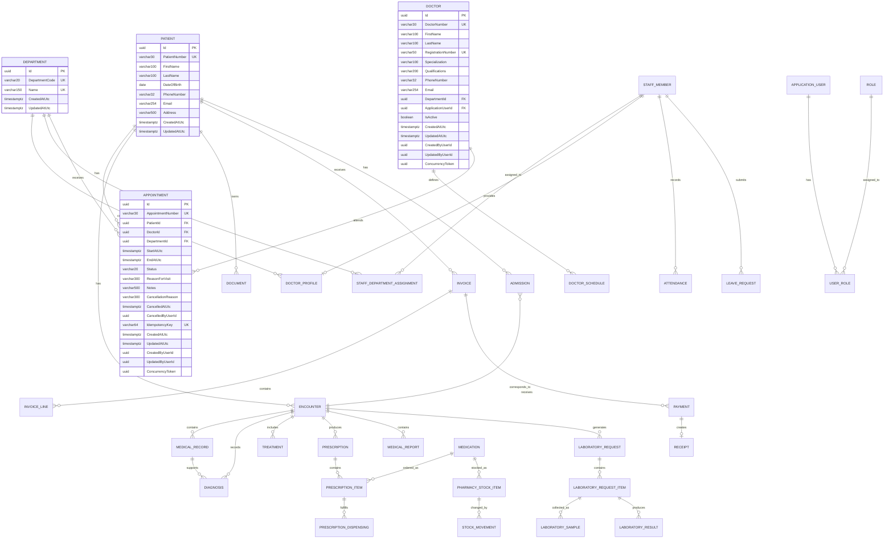

# Proposed Database Design

## Scope and implementation status

This document describes the complete relational architecture proposed for the Hospital Management System. It also distinguishes proposed work from the database foundation currently implemented.

### Already implemented

- The `HospitalDbContext` EF Core context is registered with Npgsql.
- The `Patient` table is proposed and included in the initial migration foundation.
- The `Department` table is proposed and included in the initial migration foundation.
- The existing MVC homepage remains unchanged.
- No migration is applied and no database data is created automatically.

### Implemented after the initial foundation

Identity users and roles, audit entries, patient documents, doctors, doctor schedules, appointments and clinical records are implemented in later stages and tracked in their sections below. Staff management, complete EMR, laboratory, pharmacy, billing, admissions, reporting and backup automation remain proposed.

### Implemented in Stage 4

- The `patients` table includes demographic, active/archive, audit-user and GUID concurrency-token fields.
- `patient_documents` stores document metadata and restrictively references `patients`.
- Stored files remain outside the web root and source tree; only streamed download routes access them.
- Electronic medical-record data structures are pending a later stage.

### Implemented in Stage 5

- `doctors` is linked by a required `DepartmentId` foreign key with `Restrict` deletion behavior.
- `doctors.ApplicationUserId` is optional and unique, linking one eligible Identity account to at most one doctor.
- `doctor_schedules` belongs to one doctor and stores `DayOfWeek`, local `StartTime`, `EndTime`, active status and concurrency token.
- Doctor and registration numbers use unique PostgreSQL constraints; registration numbers are normalized by removing separators and uppercasing letters.
- Initial schedules use local Asia/Colombo working hours. Storage remains `TimeOnly`/local time values and overnight sessions are rejected.
- Concurrent schedule writes use PostgreSQL transaction-scoped advisory locks plus overlap checks and database time-range/day constraints.
- Department records use `IsActive` to prevent assignments to inactive departments.

### Implemented in Stage 6: Appointments

`appointments` references one `patients` row, one `doctors` row and one `departments` row. All three foreign keys use `RESTRICT` deletion behavior so appointment history cannot be orphaned by deleting a referenced record.

| Column | PostgreSQL type | Constraints |
|---|---|---|
| `Id` | `uuid` | Primary key |
| `AppointmentNumber` | `varchar(30)` | Required, unique, sequence-generated |
| `PatientId` | `uuid` | Required FK to `patients` |
| `DoctorId` | `uuid` | Required FK to `doctors` |
| `DepartmentId` | `uuid` | Required FK to `departments` |
| `StartAtUtc`, `EndAtUtc` | `timestamp with time zone` | Required; `EndAtUtc > StartAtUtc` |
| `Status` | `varchar(20)` | Required, checked against supported lifecycle values |
| `ReasonForVisit` | `varchar(300)` | Optional |
| `Notes` | `varchar(500)` | Optional, administrative only; not clinical notes |
| `CancellationReason` | `varchar(300)` | Required by cancellation service when cancelling |
| `CancelledAtUtc` | `timestamp with time zone` | Optional |
| `CancelledByUserId` | `uuid` | Optional actor identifier |
| `IdempotencyKey` | `varchar(64)` | Required, unique together with `CreatedByUserId` |
| `BookingRequestFingerprint` | `varchar(64)` | SHA-256 hash for new rows, nullable for legacy rows |
| `CreatedAtUtc`, `UpdatedAtUtc` | `timestamp with time zone` | Required |
| `CreatedByUserId`, `UpdatedByUserId` | `uuid` | Required actor identifiers |
| `ConcurrencyToken` | `uuid` | Required optimistic concurrency token |

Appointment intervals use end-exclusive `[StartAtUtc, EndAtUtc)` semantics. The calendar/query layer converts those UTC instants to `Asia/Colombo` for presentation.

The appointment interval is stored as UTC instants, never as local wall-clock timestamps. MVC input and display convert through `Asia/Colombo`. Weekly schedule entries remain local `TimeOnly` values and are compared to the requested Colombo-local date/time before conversion.

PostgreSQL installs `btree_gist` and applies an exclusion constraint over `(DoctorId WITH =, tstzrange(StartAtUtc, EndAtUtc, '[)') WITH &&)` for `Scheduled` and `CheckedIn`. This makes interval conflicts database-enforced under simultaneous transactions. End-exclusive ranges allow a new appointment to begin exactly when another ends. `Cancelled` and `Missed` rows do not participate, so their times may be reused. The extension must be present; the migration may need DBA permission to install it.

Booking requests use a key scoped to the authenticated actor. A versioned SHA-256 fingerprint covers the original patient, doctor, department, Colombo date and start time, duration, and normalized reason and notes. The fingerprint is set on creation and survives rescheduling. Blank optional text is normalized to null and surrounding whitespace is trimmed. A same-actor retry with the same key and fingerprint returns the same appointment ID, while a different fingerprint gets a conflict. A pre-migration row has a null fingerprint and rejects reuse of its original key. Fingerprints and request free text are excluded from audit entries.

Booking takes a PostgreSQL transaction-scoped lock on the actor and key before reading a prior request. It then locks the selected doctor, checks availability, and commits the booking and audit together. Rescheduling locks the distinct source and target doctor IDs in sorted order, checks the target schedule and overlaps, and uses the appointment concurrency token to reject stale edits. The exclusion constraint still checks the final write. Sequence gaps after conflicts or rollbacks are expected.

`AddAppointmentBookingFingerprint` adds the nullable column and replaces the global key index with a unique index on actor and key. The forward migration keeps all appointment rows and the existing overlap constraint. A rollback to the old global index requires globally distinct keys, so duplicate keys across actors must be reviewed before considering a downgrade.

#### Appointment lifecycle

- `Scheduled` -> `CheckedIn`, `Cancelled` or `Missed`
- `CheckedIn` -> `Completed` or `Cancelled`
- `Completed`, `Cancelled` and `Missed` are terminal
- Cancellation requires a reason and records cancellation time and actor. Only the dedicated cancellation action can perform it. The audit entry records the transition without the free-text reason.
- Rescheduling is permitted only while `Scheduled`; it changes the appointment and audit event atomically and uses the concurrency token

The implementation does not define clinical completion or billing consequences. Appointment duration options are initially 15, 30, 45 or 60 minutes, with starts on 15-minute boundaries. This is a configurable-policy candidate, not an approved hospital-wide rule.

Availability rounds schedule openings up to the next configured clock boundary and offers only future starts whose full duration fits. Weekly schedules do not model holidays, leave, or overnight appointments.

Administrators and Receptionists can book, reschedule, cancel and apply ordinary status transitions. A Doctor can see appointments for their linked profile and check in their own scheduled appointments. Appointment availability and eligible-doctor endpoints are restricted to Administrators and Receptionists and return slot times or minimal doctor choices. The directory and calendar scope Doctor queries on the server. Other roles have no appointment access.

### Implemented in Stage 7: Electronic Medical Records

The additive `AddElectronicMedicalRecords` migration creates `clinical_encounters`, `clinical_records` and `clinical_prescription_items`. A clinical encounter references Patient, Doctor and optionally Appointment through restrictive foreign keys. A unique appointment index limits each visit to one encounter. A database trigger validates the patient and doctor against the appointment and verifies that it is checked in when the encounter opens.

The encounter owns diagnoses, prescriptions, and treatments through typed clinical records with separate stable identifiers. A revision references the prior record of the same type and encounter. A unique predecessor index keeps history linear. Prescription items keep stable IDs on draft edits and reference the prescription revision. Required fields, status checks, UTC audit stamps and GUID concurrency tokens protect the records. PostgreSQL triggers protect signed payloads and prescription lines from changes and reject deletion of encounters and clinical records. Medical reports use saved records directly and log generation through the existing audit table.

See [EMR design](emr-design.md) for workflow, role and testing details. The broader design and diagrams below include future modules and use proposed entities.

### Implemented in Stage 8: Laboratory Management

The additive AddLaboratoryManagement migration follows AddElectronicMedicalRecords. It creates five tables for catalog tests, orders, order items, samples and result versions. An order gets its patient and doctor through the existing encounter. Items snapshot catalog fields for historical reporting. Sample and prior revision references are constrained to the same item. Released reports are generated from verified result revisions. See [laboratory design](laboratory-management.md).

### Implemented in Stage 9: Pharmacy Management

AddPharmacyManagement adds medicines, medicine batches, stock movements, dispense headers and dispense lines. A dispense header references a finalized EMR prescription revision. Each line references a prescribed item from that same revision and a stock batch. The migration adds a nullable quantity unit to the existing EMR item table. Stock amounts use numeric(18,3), with whole-count rules for tablets, capsules and each. The immutable ledger and restrictive foreign keys protect inventory history. See [Pharmacy Management](pharmacy-management.md) for adopted policies.

### Implemented in Stage 10: Billing and Payments

AddBillingManagement follows AddPharmacyManagement. It adds billing services, effective prices, invoices, invoice items, payments and payment reversals. Issued invoice items snapshot descriptions, prices, source identifiers and LKR totals. Receipts are identified by the original payment, and a reversal is a separate immutable relation. Restrictive foreign keys preserve clinical and financial history. See [Billing and Payments](billing-management.md) for scope and reporting rules.

### Implemented in Stage 11: Inpatient and Outpatient Management

AddInpatientOutpatientManagement follows AddBillingManagement. It adds seven tables for wards, beds, admissions, allocations, nursing assignments, observations and signed discharge. Admissions reuse Patient and Doctor, and optionally reference the originating ClinicalEncounter. OPD reuses Appointment and ClinicalEncounter. PostgreSQL uses half-open timestamp ranges, partial unique indexes and deferred checks to enforce exclusive occupancy and a single open admission per patient. Invoice items can reference a discharged admission through a restrictive foreign key. See [Inpatient and Outpatient Management](inpatient-outpatient-management.md).

## Core conventions

- PostgreSQL `uuid` values are used for primary and foreign keys.
- `DateOnly` is used for calendar-only values such as date of birth and leave dates.
- UTC `timestamp with time zone` values are used for audit, creation, update and event timestamps.
- Application timestamps should use `DateTimeKind.Utc`.
- Logical deletion is evaluated separately from audit retention; destructive deletion of clinical and financial records should not be used by default.
- Unique indexes enforce stable identifiers and prevent duplicate logical records.
- Foreign keys use approved restrict/cascade behavior according to business meaning. Audit and clinical records should normally prohibit destructive parent deletion.
- Every mutable record intended for concurrent editing should include a PostgreSQL `xmin` concurrency token or an application-managed row-version strategy.
- Access to clinical and financial data must be enforced by authorization policies, not only hidden UI elements.

## Initial entities

### Patient

| Column | PostgreSQL type | Constraints |
|---|---|---|
| `Id` | `uuid` | Primary key |
| `PatientNumber` | `varchar(30)` | Required, unique |
| `FirstName` | `varchar(100)` | Required |
| `LastName` | `varchar(100)` | Required |
| `DateOfBirth` | `date` | Required |
| `PhoneNumber` | `varchar(32)` | Optional |
| `Email` | `varchar(254)` | Optional |
| `Address` | `varchar(500)` | Optional |
| `CreatedAtUtc` | `timestamp with time zone` | Required |
| `UpdatedAtUtc` | `timestamp with time zone` | Required |

### Department

| Column | PostgreSQL type | Constraints |
|---|---|---|
| `Id` | `uuid` | Primary key |
| `DepartmentCode` | `varchar(20)` | Required, unique |
| `Name` | `varchar(150)` | Required, unique in this foundation |
| `CreatedAtUtc` | `timestamp with time zone` | Required |
| `UpdatedAtUtc` | `timestamp with time zone` | Required |

### Doctor

| Column                | PostgreSQL type         | Constraints                                  |
|---------------------- |------------------------|----------------------------------------------|
| `Id`                  | `uuid`                 | Primary key                                  |
| `DoctorNumber`        | `varchar(30)`          | Required, unique                             |
| `FirstName`           | `varchar(100)`         | Required                                     |
| `LastName`            | `varchar(100)`         | Required                                     |
| `RegistrationNumber`  | `varchar(50)`          | Required, unique (normalized, see below)     |
| `Specialization`      | `varchar(100)`         | Required                                     |
| `Qualifications`      | `varchar(200)`         | Optional                                     |
| `PhoneNumber`         | `varchar(32)`          | Optional                                     |
| `Email`               | `varchar(254)`         | Optional                                     |
| `DepartmentId`        | `uuid`                 | Required, FK to departments                  |
| `ApplicationUserId`   | `uuid`                 | Optional, FK to application_users            |
| `IsActive`            | `boolean`              | Required, default true                       |
| `CreatedAtUtc`        | `timestamp with time zone` | Required                                 |
| `UpdatedAtUtc`        | `timestamp with time zone` | Required                                 |
| `CreatedByUserId`     | `uuid`                 | Optional                                     |
| `UpdatedByUserId`     | `uuid`                 | Optional                                     |
| `ConcurrencyToken`    | `uuid`                 | Required, concurrency check                  |

- `DoctorNumber` is generated by the server and unique.
- `RegistrationNumber` must be unique after normalization (uppercase, no spaces). Enforced by application and unique index.
- `DepartmentId` is a foreign key to `departments` (restrict delete).
- `ApplicationUserId` is a foreign key to `application_users` (restrict delete, unique, nullable).
- No physical deletion; use `IsActive` for logical deletion.
- UTC timestamps for audit.
- Optimistic concurrency via `ConcurrencyToken`.

## Complete proposed entity set

| Entity | Purpose | Primary key | Major foreign keys |
|---|---|---|---|
| `Role` | Approved hospital role | `Id` | — |
| `ApplicationUser` | Login principal | `Id` | Staff/person relationship when approved |
| `UserRole` | Many-to-many role assignment | `UserId, RoleId` | `UserId`, `RoleId` |
| `StaffMember` | Registered staff identity | `Id` | `UserId`, optional department relationships |
| `Department` | Clinical or administrative department | `Id` | — |
| `StaffDepartmentAssignment` | Staff-department assignment | `Id` | `StaffMemberId`, `DepartmentId` |
| `DoctorProfile` | Doctor-specific profile | `Id` | `StaffMemberId`, `DepartmentId` |
| `DoctorSchedule` | Repeating or dated availability | `Id` | `DoctorProfileId`, `DepartmentId` |
| `Appointment` | Patient visit booking | `Id` | `PatientId`, `DoctorProfileId`, `DepartmentId` |
| `Encounter` | Outpatient/inpatient care episode | `Id` | `PatientId`, `DoctorProfileId`, `DepartmentId` |
| `MedicalRecord` | Encounter clinical summary | `Id` | `EncounterId`, `PatientId`, `AuthorStaffId` |
| `Diagnosis` | Clinical diagnosis | `Id` | `MedicalRecordId`, `PatientId`, `DiagnosisCodeId` |
| `Prescription` | Provider medication order | `Id` | `EncounterId`, `PatientId`, `PrescriberId` |
| `PrescriptionItem` | Medication line | `Id` | `PrescriptionId`, `MedicationId` |
| `Treatment` | Treatment or procedure record | `Id` | `EncounterId`, `PatientId`, `ProviderId` |
| `MedicalReport` | Report linked to an encounter | `Id` | `EncounterId`, `PatientId`, `AuthorStaffId` |
| `Document` | Uploaded patient or clinical document | `Id` | `PatientId`, optional encounter or staff owner |
| `LaboratoryRequest` | Ordered laboratory tests | `Id` | `EncounterId`, `PatientId`, `OrderingProviderId` |
| `LaboratoryRequestItem` | Individual test | `Id` | `LaboratoryRequestId`, `LaboratoryTestId` |
| `LaboratorySample` | Collected physical sample | `Id` | `LaboratoryRequestItemId`, `CollectorId` |
| `LaboratoryResult` | Measured result | `Id` | `LaboratoryRequestItemId`, `VerifierId` |
| `Medication` | Catalog medication | `Id` | — |
| `PharmacyStockItem` | Batch or stock location balance | `Id` | `MedicationId`, optional location |
| `StockMovement` | Inventory transaction | `Id` | `StockItemId`, `ActorId`, optional prescription item |
| `PrescriptionDispensing` | Pharmacy processing record | `Id` | `PrescriptionItemId`, `StockItemId`, `DispenserId` |
| `Invoice` | Bill aggregate | `Id` | `PatientId`, optional encounter/admission |
| `InvoiceLine` | Charge line | `Id` | `InvoiceId`, optional source encounter/order/item |
| `Payment` | Applied payment | `Id` | `InvoiceId`, `ReceivedById` |
| `Receipt` | Payment acknowledgment | `Id` | `PaymentId`, `InvoiceId` |
| `Admission` | Inpatient stay | `Id` | `PatientId`, `EncounterId`, `DepartmentId` |
| `Attendance` | Staff attendance record | `Id` | `StaffMemberId` |
| `LeaveRequest` | Staff leave request | `Id` | `StaffMemberId`, `ApproverId` |
| `AuditLog` | Security and business audit event | `Id` | Optional `ActorId`, polymorphic entity reference fields |

## Relationships and constraints

- One `Patient` can have many appointments, encounters, medical records, prescriptions, laboratory requests, documents, invoices and admissions.
- One `Department` can have many doctor profiles, staff assignments, schedules and encounters.
- One `DoctorProfile` belongs to one staff member and department, and can have many schedules and appointments.
- One `StaffMember` can belong to many departments through `StaffDepartmentAssignment`; the relationship can include a primary assignment flag.
- One `ApplicationUser` is linked to many roles through a join entity. The exact staff/person relationship is resolved during Identity implementation.
- One `Encounter` can contain medical records, diagnoses, treatments, reports, prescriptions and laboratory requests.
- One `Prescription` has many items. A prescription item must not dispense more quantity than it permits or than available stock under approved policy.
- One laboratory request has many test items, each item may have samples and results.
- Pharmacy stock movements append inventory changes; normal balances should not be edited directly.
- One `Invoice` has many charge lines and payments. A payment is not allowed to create an orphaned receipt or exceed the approved allocation under local policy.
- One admission is associated with one inpatient encounter and department; discharge details use a state transition table or fields governed by business rules.
- Clinical, financial and audit records use append-oriented or state-based lifecycle rules. Referential integrity must prevent accidental deletion of dependent records.
- Email and phone formats, patient date-of-birth ranges, stock quantities, payment totals, status transitions and billing reconciliation require database and application validation.

## Proposed Mermaid ER diagram

The diagram includes the initial entities and the major future groups. Identity and reporting tables are intentionally summarized until implementation stages are approved.

## Indexing and performance guidance

Initial foundations include a unique patient number index, a patient name index and unique department code/name indexes. Future indexes should be measured rather than guessed and should cover frequent filters such as appointment date/provider/status, encounter patient/date, laboratory status, invoice status/date and audit entity/action/time.

## Business-policy assumptions requiring approval

1. Patient numbers follow a local formatting and allocation policy.
2. Duplicate patients are prevented or resolved according to an approved identity-matching procedure.
3. Department names must be unique; this foundation currently enforces that assumption.
4. The final patient retention, anonymization and deletion policy has not been approved.
5. The required appointment and encounter status state machines need to be approved.
6. Clinical record amendment/correction rules and electronic-signature requirements need approval.
7. Laboratory ranges, critical-result notifications and result-release policy need approval.
8. Prescription validity, refill, controlled-drug and dispensing rules need approval.
9. Pharmacy batch selection, partial dispensing and stock adjustment policies need approval.
10. Invoice rounding, tax, insurance, discount, overpayment, refund and receipt policies need approval.
11. Admission, bed, occupancy and discharge policies need approval.
12. Leave approval hierarchy and attendance rounding rules need approval.
13. Audit log fields, retention period and immutability mechanism need approval.
14. Backup RPO, RTO, encryption, retention and restore-access policy need approval.
15. Date/time display must include hospital timezone and daylight-saving behavior; storage remains UTC.

## Security and data protection

- Do not store raw passwords in application tables; ASP.NET Core Identity should be used for Identity data.
- Use least-privilege PostgreSQL roles. The application role should not own or be the administrator role.
- Keep secrets in environment variables or secure configuration stores, never source control.
- Apply authorization in controllers/services and database-level access controls where the environment requires stronger isolation.
- Plan encrypted backups and restricted restore procedures.

## Staff management

Employee profiles can link to one existing Identity user. Department assignments reference existing departments and record effective periods. Attendance sessions and leave requests belong to employees. Attendance corrections preserve prior times, and leave decisions preserve the actor, time and disposition. Leave requests reference the configured leave type. PostgreSQL exclusion constraints enforce non-overlapping department assignments, attendance sessions and pending or approved leave for each employee.

## Stage 13 reporting

Reporting projects existing domain records into summaries and paginated detail views. It adds no reporting tables, caches or schema migration. See the [report definitions](hospital-reports-dashboard.md) for source tables and event timestamps.
