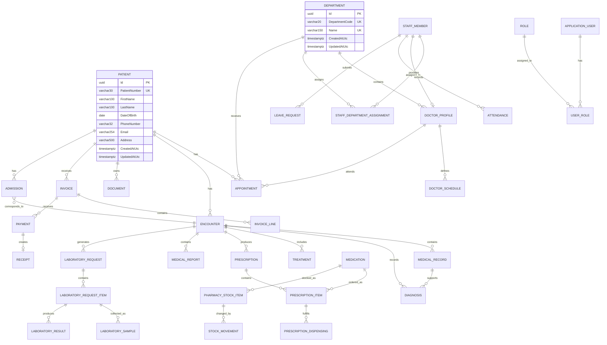

# Proposed Database Design

## Scope and implementation status

This document describes the complete relational architecture proposed for the Hospital Management System. It also distinguishes proposed work from the database foundation currently implemented.

### Already implemented

- The `HospitalDbContext` EF Core context is registered with Npgsql.
- The `Patient` table is proposed and included in the initial migration foundation.
- The `Department` table is proposed and included in the initial migration foundation.
- The existing MVC homepage remains unchanged.
- No migration is applied and no database data is created automatically.

### Proposed, not yet implemented

Identity users and roles, staff, doctor profiles, schedules, appointments, clinical records, laboratories, pharmacy, billing, admissions, documents, audit logs, and backups are architectural proposals only.

### Implemented in Stage 4

- The `patients` table includes demographic, active/archive, audit-user and GUID concurrency-token fields.
- `patient_documents` stores document metadata and restrictively references `patients`.
- Stored files remain outside the web root and source tree; only streamed download routes access them.
- Electronic medical-record data structures are pending a later stage.

## Core conventions

- PostgreSQL `uuid` values are used for primary and foreign keys.
- `DateOnly` is used for calendar-only values such as date of birth and leave dates.
- UTC `timestamp with time zone` values are used for audit, creation, update and event timestamps.
- Application timestamps should use `DateTimeKind.Utc`.
- Logical deletion is evaluated separately from audit retention; destructive deletion of clinical and financial records should not be used by default.
- Unique indexes enforce stable identifiers and prevent duplicate logical records.
- Foreign keys use approved restrict/cascade behavior according to business meaning. Audit and clinical records should normally prohibit destructive parent deletion.
- Every mutable record intended for concurrent editing should include a PostgreSQL `xmin` concurrency token or an application-managed row-version strategy.
- Access to clinical and financial data must be enforced by authorization policies, not only hidden UI elements.

## Initial entities

### Patient

| Column | PostgreSQL type | Constraints |
|---|---|---|
| `Id` | `uuid` | Primary key |
| `PatientNumber` | `varchar(30)` | Required, unique |
| `FirstName` | `varchar(100)` | Required |
| `LastName` | `varchar(100)` | Required |
| `DateOfBirth` | `date` | Required |
| `PhoneNumber` | `varchar(32)` | Optional |
| `Email` | `varchar(254)` | Optional |
| `Address` | `varchar(500)` | Optional |
| `CreatedAtUtc` | `timestamp with time zone` | Required |
| `UpdatedAtUtc` | `timestamp with time zone` | Required |

### Department

| Column | PostgreSQL type | Constraints |
|---|---|---|
| `Id` | `uuid` | Primary key |
| `DepartmentCode` | `varchar(20)` | Required, unique |
| `Name` | `varchar(150)` | Required, unique in this foundation |
| `CreatedAtUtc` | `timestamp with time zone` | Required |
| `UpdatedAtUtc` | `timestamp with time zone` | Required |

## Complete proposed entity set

| Entity | Purpose | Primary key | Major foreign keys |
|---|---|---|---|
| `Role` | Approved hospital role | `Id` | — |
| `ApplicationUser` | Login principal | `Id` | Staff/person relationship when approved |
| `UserRole` | Many-to-many role assignment | `UserId, RoleId` | `UserId`, `RoleId` |
| `StaffMember` | Registered staff identity | `Id` | `UserId`, optional department relationships |
| `Department` | Clinical or administrative department | `Id` | — |
| `StaffDepartmentAssignment` | Staff-department assignment | `Id` | `StaffMemberId`, `DepartmentId` |
| `DoctorProfile` | Doctor-specific profile | `Id` | `StaffMemberId`, `DepartmentId` |
| `DoctorSchedule` | Repeating or dated availability | `Id` | `DoctorProfileId`, `DepartmentId` |
| `Appointment` | Patient visit booking | `Id` | `PatientId`, `DoctorProfileId`, `DepartmentId` |
| `Encounter` | Outpatient/inpatient care episode | `Id` | `PatientId`, `DoctorProfileId`, `DepartmentId` |
| `MedicalRecord` | Encounter clinical summary | `Id` | `EncounterId`, `PatientId`, `AuthorStaffId` |
| `Diagnosis` | Clinical diagnosis | `Id` | `MedicalRecordId`, `PatientId`, `DiagnosisCodeId` |
| `Prescription` | Provider medication order | `Id` | `EncounterId`, `PatientId`, `PrescriberId` |
| `PrescriptionItem` | Medication line | `Id` | `PrescriptionId`, `MedicationId` |
| `Treatment` | Treatment or procedure record | `Id` | `EncounterId`, `PatientId`, `ProviderId` |
| `MedicalReport` | Report linked to an encounter | `Id` | `EncounterId`, `PatientId`, `AuthorStaffId` |
| `Document` | Uploaded patient or clinical document | `Id` | `PatientId`, optional encounter or staff owner |
| `LaboratoryRequest` | Ordered laboratory tests | `Id` | `EncounterId`, `PatientId`, `OrderingProviderId` |
| `LaboratoryRequestItem` | Individual test | `Id` | `LaboratoryRequestId`, `LaboratoryTestId` |
| `LaboratorySample` | Collected physical sample | `Id` | `LaboratoryRequestItemId`, `CollectorId` |
| `LaboratoryResult` | Measured result | `Id` | `LaboratoryRequestItemId`, `VerifierId` |
| `Medication` | Catalog medication | `Id` | — |
| `PharmacyStockItem` | Batch or stock location balance | `Id` | `MedicationId`, optional location |
| `StockMovement` | Inventory transaction | `Id` | `StockItemId`, `ActorId`, optional prescription item |
| `PrescriptionDispensing` | Pharmacy processing record | `Id` | `PrescriptionItemId`, `StockItemId`, `DispenserId` |
| `Invoice` | Bill aggregate | `Id` | `PatientId`, optional encounter/admission |
| `InvoiceLine` | Charge line | `Id` | `InvoiceId`, optional source encounter/order/item |
| `Payment` | Applied payment | `Id` | `InvoiceId`, `ReceivedById` |
| `Receipt` | Payment acknowledgment | `Id` | `PaymentId`, `InvoiceId` |
| `Admission` | Inpatient stay | `Id` | `PatientId`, `EncounterId`, `DepartmentId` |
| `Attendance` | Staff attendance record | `Id` | `StaffMemberId` |
| `LeaveRequest` | Staff leave request | `Id` | `StaffMemberId`, `ApproverId` |
| `AuditLog` | Security and business audit event | `Id` | Optional `ActorId`, polymorphic entity reference fields |

## Relationships and constraints

- One `Patient` can have many appointments, encounters, medical records, prescriptions, laboratory requests, documents, invoices and admissions.
- One `Department` can have many doctor profiles, staff assignments, schedules and encounters.
- One `DoctorProfile` belongs to one staff member and department, and can have many schedules and appointments.
- One `StaffMember` can belong to many departments through `StaffDepartmentAssignment`; the relationship can include a primary assignment flag.
- One `ApplicationUser` is linked to many roles through a join entity. The exact staff/person relationship is resolved during Identity implementation.
- One `Encounter` can contain medical records, diagnoses, treatments, reports, prescriptions and laboratory requests.
- One `Prescription` has many items. A prescription item must not dispense more quantity than it permits or than available stock under approved policy.
- One laboratory request has many test items, each item may have samples and results.
- Pharmacy stock movements append inventory changes; normal balances should not be edited directly.
- One `Invoice` has many charge lines and payments. A payment is not allowed to create an orphaned receipt or exceed the approved allocation under local policy.
- One admission is associated with one inpatient encounter and department; discharge details use a state transition table or fields governed by business rules.
- Clinical, financial and audit records use append-oriented or state-based lifecycle rules. Referential integrity must prevent accidental deletion of dependent records.
- Email and phone formats, patient date-of-birth ranges, stock quantities, payment totals, status transitions and billing reconciliation require database and application validation.

## Proposed Mermaid ER diagram

The diagram includes the initial entities and the major future groups. Identity and reporting tables are intentionally summarized until implementation stages are approved.

## Indexing and performance guidance

Initial foundations include a unique patient number index, a patient name index and unique department code/name indexes. Future indexes should be measured rather than guessed and should cover frequent filters such as appointment date/provider/status, encounter patient/date, laboratory status, invoice status/date and audit entity/action/time.

## Business-policy assumptions requiring approval

1. Patient numbers follow a local formatting and allocation policy.
2. Duplicate patients are prevented or resolved according to an approved identity-matching procedure.
3. Department names must be unique; this foundation currently enforces that assumption.
4. The final patient retention, anonymization and deletion policy has not been approved.
5. The required appointment and encounter status state machines need to be approved.
6. Clinical record amendment/correction rules and electronic-signature requirements need approval.
7. Laboratory ranges, critical-result notifications and result-release policy need approval.
8. Prescription validity, refill, controlled-drug and dispensing rules need approval.
9. Pharmacy batch selection, partial dispensing and stock adjustment policies need approval.
10. Invoice rounding, tax, insurance, discount, overpayment, refund and receipt policies need approval.
11. Admission, bed, occupancy and discharge policies need approval.
12. Leave approval hierarchy and attendance rounding rules need approval.
13. Audit log fields, retention period and immutability mechanism need approval.
14. Backup RPO, RTO, encryption, retention and restore-access policy need approval.
15. Date/time display must include hospital timezone and daylight-saving behavior; storage remains UTC.

## Security and data protection

- Do not store raw passwords in application tables; ASP.NET Core Identity should be used for Identity data.
- Use least-privilege PostgreSQL roles. The application role should not own or be the administrator role.
- Keep secrets in environment variables or secure configuration stores, never source control.
- Apply authorization in controllers/services and database-level access controls where the environment requires stronger isolation.
- Plan encrypted backups and restricted restore procedures.
